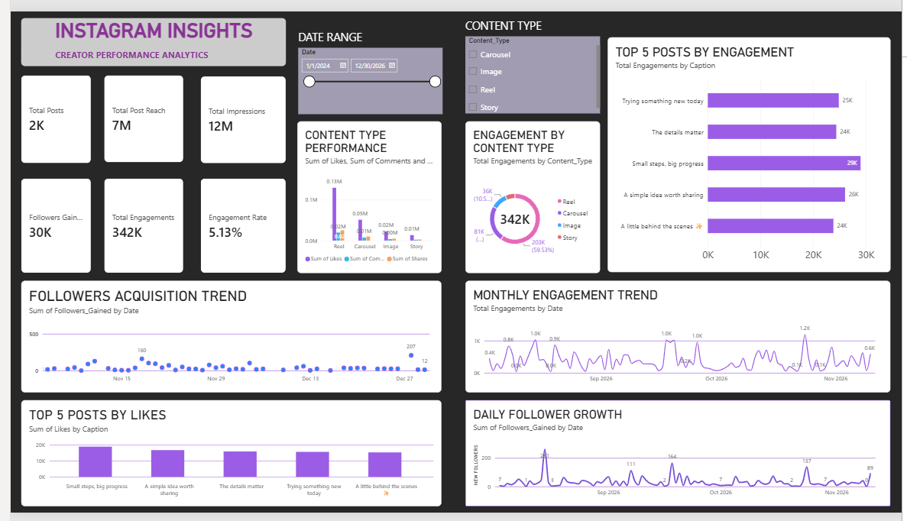
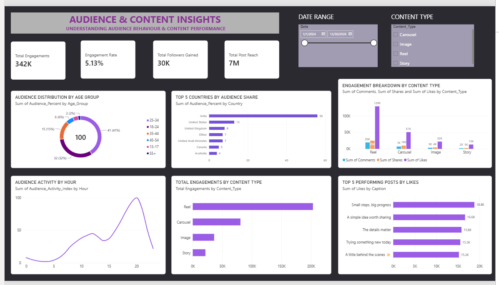

# 📊 Instagram Insights — Creator Analytics Dashboard

An interactive Power BI dashboard designed to analyse Instagram creator performance, audience behaviour, and content engagement.

## 📸 Dashboard Preview

### Page 1 — Instagram Insights

### Page 2 — Audience & Content Insights

## 🎯 Project Objectives

- Analyse overall Instagram content performance.
- Track reach, impressions, engagement, and follower growth.
- Identify top-performing posts.
- Understand audience demographics and geographic distribution.
- Compare engagement across different content types.

## 🛠️ Tools & Technologies

- Microsoft Power BI
- Power Query
- DAX (Data Analysis Expressions)
- Microsoft Excel
- Data Visualization

## 📈 Key Dashboard Features

- KPI cards for posts, reach, impressions, and engagement.
- Monthly engagement and follower growth trends.
- Top 5 posts by likes and engagement.
- Engagement breakdown by content type.
- Audience distribution by age group and country.
- Interactive date range and content type filters.

## 📂 Dataset

This project uses a **synthetic (simulated) Instagram dataset** created for educational and portfolio purposes. It does not contain actual Instagram account data.

## 💡 Key Insights

- Reels contribute the highest engagement in the simulated dataset.
- Audience distribution is strongest in the 25–34 age group.
- India represents the largest audience share.
- The dashboard helps compare content performance and identify engagement patterns.

## 👨‍💻 About

Created as a Data Analytics portfolio project to demonstrate data cleaning, data modelling, DAX calculations, and interactive dashboard development using Power BI.

**Author:** Suraj Kumar Singh
